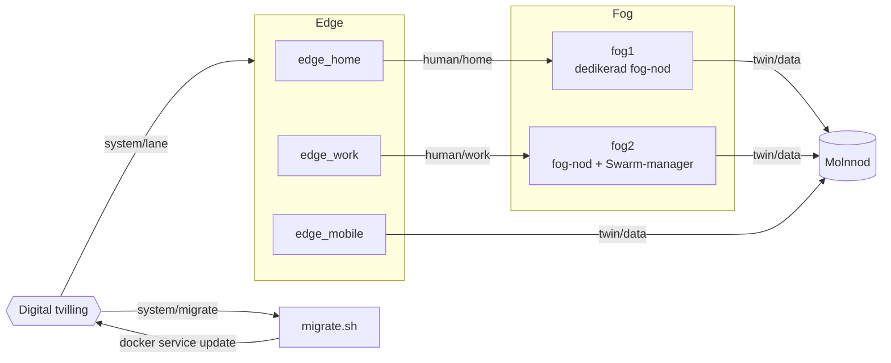
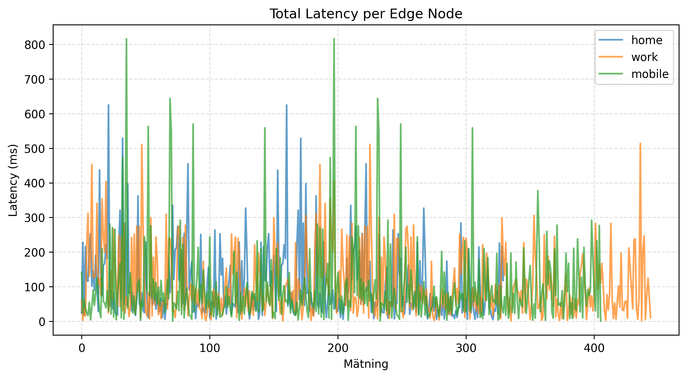

# Distribuerat digitalt tvillingsystem med edge-, fog- och molnberäkning

Examensarbete (15 hp), kandidatprogrammet i datateknik vid Mittuniversitetet, vår 2026.

En digital tvilling som **migrerar automatiskt mellan edge-noder** beroende på var användaren befinner sig (hemma, på jobbet eller på resande fot). Systemet körs på ett kluster med fem Raspberry Pi och en molnnod, med C++-tjänster i Docker-containrar som orkestreras med **Docker Swarm** och kommunicerar via **MQTT**.

📄 Fullständig rapport: *Distribuerat digitalt tvillingsystem med MQTT, edge- och fog-beräkning och dockeriserade C++ noder* (DiVA)

## Arkitektur



| Komponent | Roll |
|---|---|
| **Edge-noder** (`edge/`) | Simulerar sensordata från tre miljöer: hem, jobb och mobil |
| **Fog-noder** (`fog/`) | Tar emot data från närliggande edge-noder och vidarebefordrar till molnet |
| **Molnnod** (`cloud/`) | Tar emot all data och loggar latens per segment |
| **Digital tvilling** (`twin/`) | Timerstyrd tjänst som byter fas och skickar migreringskommandon |
| **Orkestrering** (`migrate.sh`) | Lyssnar på `system/migrate` och flyttar tvillingens container via `docker service update` |

### MQTT-topics

| Topic | Publiceras av | Prenumereras av | Syfte |
|---|---|---|---|
| `human/home` | edge_home | fog1 | Sensordata från hemmet |
| `human/work` | edge_work | fog2 | Sensordata från jobbet |
| `twin/data` | edge_mobile, fog1, fog2 | molnnod | Sensordata till molnet |
| `system/lane` | digital tvilling | edge-noder | Aktivering/avaktivering av edge-noder |
| `system/migrate` | digital tvilling | orkestreringsskript | Migreringskommandon |

## Resultat

Latensen mättes över **1 460 meddelanden** efter NTP-synkronisering av alla noder.

| Kommunikationsväg | Edge → fog (medel) | Total latens (medel) | Std. avvikelse |
|---|---|---|---|
| Hem (via dedikerad fog1) | **22,6 ms** | 106,2 ms | 106,8 ms |
| Jobb (via fog2 som även är Swarm-manager) | 48,7 ms | 108,2 ms | 97,0 ms |
| Mobil (direkt till molnet) | – | 99,3 ms | **118,9 ms** |

**Slutsatser**
- Fog-lagret **stabiliserar latensen**: den mobila vägen utan fog hade högst variation och de mest extrema avvikelserna.
- En fog-nod som även är Swarm-manager fick **nästan dubbelt så hög edge-to-fog-latens**. Kontrollplanet bör därför separeras från databehandlingen.
- Docker Swarm tillsammans med MQTT fungerar som plattform för migrerbara digitala tvillingar.



## Teknik

C++ · Docker · Docker Swarm · MQTT (Eclipse Mosquitto, Paho MQTT C++) · nlohmann/json · Raspberry Pi · Linux · Bash · Python (analys och grafer)

## Köra systemet

Kräver ett Docker Swarm-kluster där noderna har etiketter (`node.labels.edge=home|work|mobile`) och värdnamn som matchar `docker-stack.yml`. IP-adresserna till brokers ställs in i `common/config.hpp` och `docker-stack.yml`.

```bash
# Bygg basimage med beroenden och sedan tjänsterna
docker build -t project-base -f Dockerfile.base .
docker build -t edge  -f edge/Dockerfile .
docker build -t fog   -f fog/Dockerfile .
docker build -t twin  -f twin/Dockerfile .

# Driftsätt i klustret
docker stack deploy -c docker-stack.yml dt

# Starta migreringsskriptet på manager-noden
./migrate.sh
```

## Författare

**Hussein Shaker**: [LinkedIn](https://www.linkedin.com/in/hussein-shaker-0834a539b/) · [GitHub](https://github.com/husseinShakerr)

Handledare: Stefan Forsström · Examinator: Patrik Österberg
